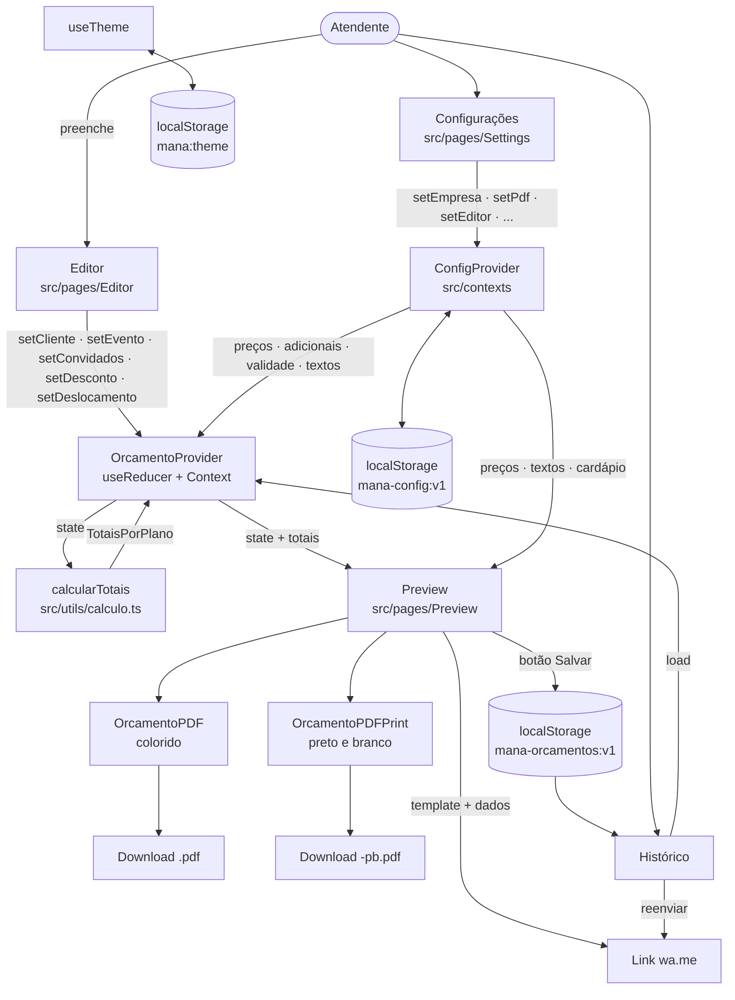

# Arquitetura

Mapa de como o app de orçamentos da Maná Pizzas & Eventos está organizado **hoje**. Descreve o que existe no código, não o que seria ideal — os pontos em que a implementação atual se afasta do desejável estão listados, como tal, em [Débitos técnicos conhecidos](#débitos-técnicos-conhecidos).

Para regras de cálculo com fórmula e exemplos, ver [REGRAS-DE-NEGOCIO.md](REGRAS-DE-NEGOCIO.md). Para comandos e convenções, ver o [README](../README.md) e o [CLAUDE.md](../CLAUDE.md).

## Visão em 30 segundos

- **100% client-side.** Vite + React 19 + TypeScript servem uma SPA com quatro rotas. Não há servidor de aplicação, API, banco nem autenticação.
- **Todo o estado é local.** O orçamento em edição vive em um `useReducer`; a configuração e o histórico vivem no `localStorage`.
- **O número é calculado no cliente**, em `src/utils/calculo.ts`, a partir dos preços da configuração.
- **O PDF é o produto.** `@react-pdf/renderer` monta um documento colorido e outro preto e branco a partir do mesmo estado e dos mesmos totais.
- **A entrega é o WhatsApp** (link `wa.me` com texto gerado por template).

## Fluxo de dados



O detalhe importante: **o Editor só alimenta o estado**. Ele não calcula nem exibe totais. O cálculo acontece no provider (`OrcamentoProvider`, consumido por `useOrcamento`) e os números aparecem no PDF; o Histórico grava uma cópia dos totais no momento do "Salvar".

## Camadas e mapa de módulos

### 1. Bootstrap e rotas

| Arquivo | Responsabilidade |
|---|---|
| `index.html` | Documento HTML, tema escuro inicial, título e favicon (referência quebrada, ver débitos). |
| `src/main.tsx` | Cria a raiz React e importa os estilos globais (`fonts.scss`, `tokens.scss`, `global.scss`). |
| `src/App.tsx` | Compõe `ConfigProvider` → `OrcamentoProvider` → `RouterProvider` e declara as rotas: `/` (Editor), `/preview` (lazy), `/history`, `/settings`. |
| `vite.config.ts` | Plugin React, alias `@ → ./src`, CORS em dev/preview e configuração do Vitest (jsdom, `tests/setup.ts`). |

O `Preview` é o único carregamento lazy; é ele quem puxa `@react-pdf/renderer` para um chunk separado.

### 2. Páginas

| Página | Arquivo | Papel |
|---|---|---|
| Editor | `src/pages/Editor/index.tsx` (171 linhas) | Formulário de cliente, evento, convidados, deslocamento e desconto. Grava direto no `useOrcamento`. |
| Preview | `src/pages/Preview/index.tsx` (238 linhas) | Resumo, viewer do PDF, download colorido e P&B, link do WhatsApp e "Salvar". |
| Histórico | `src/pages/History/index.tsx` (241 linhas) | Lista agrupada por mês, busca por cliente, status, abrir/duplicar/excluir/reenviar. |
| Configurações | `src/pages/Settings/index.tsx` (631 linhas) | Oito seções de configuração, exportar/importar JSON e restaurar padrão. |

As páginas conversam com o domínio **apenas** por `useOrcamento` e `useConfig` (e por `src/services/orcamentos` no caso de Histórico, que lê a lista diretamente).

### 3. Estado da aplicação (`src/contexts/` e `src/hooks/`)

| Módulo | Responsabilidade |
|---|---|
| `src/contexts/OrcamentoProvider.tsx` | Provider do orçamento em edição. `useReducer` com ações `setCliente`, `setEvento`, `setConvidados`, `setPagamento`, `setDesconto`, `setDeslocamento`, `reset`, `load`. Expõe `TotaisPorPlano` memoizado e `toOrcamento(id?)`. Lê a config via `ConfigContext` (não via `useConfig`, para não exigir o provider na ordem). |
| `src/contexts/orcamentoReducer.ts` | `Action`, `buildInitialState(config)` e `reducer` — a lógica de estado, separada do componente React. |
| `src/contexts/orcamentoContext.ts` | `OrcamentoContext` e o tipo `OrcamentoCtx` (a superfície exposta às páginas). |
| `src/contexts/ConfigProvider.tsx` | Provider da configuração da pizzaria. Estado espelhado no `localStorage`, setters por seção, `reset`, `exportar`, `importar`, e sincronização entre abas pelo evento `storage`. |
| `src/contexts/configContext.ts` | `ConfigContext`, o tipo `ConfigCtx` e a chave `CONFIG_STORAGE_KEY`. |
| `src/hooks/useOrcamento.ts` | Hook de consumo do `OrcamentoContext`. Reexporta os tipos `State`/`LoadableState` de `src/types/orcamento.ts`. |
| `src/hooks/useConfig.ts` | Hook de consumo do `ConfigContext`. |
| `src/hooks/useTheme.ts` | Tema claro/escuro persistido em `mana:theme`, aplicado como `data-theme` e `colorScheme` no `<html>`. |

**Estado versus derivado:** só `state` é armazenado. `totais` é derivado por `useMemo` a partir de `state`, `config.pdf.precos` e `config.pdf.adicionais`. Não existe cache de cálculo.

**Ciclo de vida do orçamento:** `buildInitialState(config)` define convidados, forma de pagamento e deslocamento a partir dos padrões do editor. `reset` volta a esse estado. `load` substitui o estado inteiro (usado pelo Histórico). Salvar não altera o estado em edição — apenas grava uma cópia em `src/services/orcamentos.ts`.

### 4. Domínio (`src/utils/`)

| Módulo | Responsabilidade |
|---|---|
| `src/utils/calculo.ts` | `precoPlano`, `calcularSubtotal` por plano, `calcularTotais` (deslocamento, desconto, total à vista, parcela) e `validarDeslocamento`. Reexporta `calcularConvidados`, `calcularPizzasSugeridas` e `dataValidade` para manter a API pública. |
| `src/utils/convidados.ts` | `calcularConvidados` (adultos + meia entrada 5–9 + grátis 0–4), `calcularPizzasSugeridas` (0,6 pizza por convidado equivalente, arredondado para cima) e os multiplicadores `MULTIPLICADOR_CRIANCA_5A9`/`MULTIPLICADOR_CRIANCA_0A4`. |
| `src/utils/validade.ts` | `dataValidade` (data + horas de validade). |
| `src/utils/datas.ts` | `MESES`, `formatarMes` (agrupamento por mês) e `formatarData` (data por extenso em pt-BR). |
| `src/utils/whatsapp.ts` | `mensagemWhatsApp` (interpolação parametrizada do template) e `linkWhatsApp` (link `wa.me`). |
| `src/utils/orcamento.ts` | `statusDoOrcamento` (Rascunho / Válido / Expirado). |
| `src/utils/money.ts` | Formatação BRL (`formatBRL`, `formatBRLCompact`, `formatCentavos`), parsing (`parseBRL`), `roundParcela` e `applyDescontoAvista`. É a implementação canônica de moeda do app. |

`calcularTotais` é a **única** fonte dos totais que alimentam o PDF e o Histórico (o `salvarOrcamento` grava os `totais` calculados por ele). Ainda assim, há números recalculados dentro do PDF fora desse caminho (ver débito 7). A ordem das operações é: subtotal → + deslocamento → − desconto manual → total; o total à vista aplica o desconto percentual configurado sobre esse total; a parcela é o total dividido pelo número de parcelas.

**O domínio não depende mais da camada de estado.** O tipo `State` vive em `src/types/orcamento.ts`, e `utils/` importa apenas tipos de `src/types/` e constantes de `src/services/`. O ciclo `utils ↔ hooks` foi eliminado no estágio 2 do epic PAMP-221.

**Os utilitários canônicos ainda não têm consumidores.** `whatsapp.ts`, `datas.ts` e `orcamento.ts` foram criados no estágio 2, mas Preview, Histórico, Configurações e Editor continuam com as cópias inline (ver débito 39). A migração das páginas é do estágio 3.

### 5. Dados comerciais (`src/services/`)

| Módulo | Responsabilidade |
|---|---|
| `src/services/precos.ts` | **Origem única dos números comerciais** (preços, adicionais, desconto à vista, parcelas, limite de km e fator de pizzas): `PRECOS_PLANOS` (4 planos × parcelado/à vista), `ADICIONAL_ENTRADA`, `ADICIONAL_SALGADO_EXTRA`, `DESCONTO_AVISTA`, `PARCELAS`, `LIMITE_KM_DESLOCAMENTO`, `BATE_LIMITE_HORAS` e `PIZZAS_POR_CONVIDADO`. |
| `src/services/planos.ts` | Os quatro planos: id, nome, tagline, descrição, ícone, cor, preços parcelado/à vista (derivados de `precos.ts`), inclusos, bônus e (no Premium) sabores/destaques. Também exporta `OPCIONAIS` (rótulos/valores exibidos no Editor). |

Os preços **efetivos** vêm de `Config.pdf.precos`; os valores de `planos.ts` são fallback quando `calcularTotais` é chamada sem `precos`. Como `CONFIG_DEFAULT.pdf.precos` e `CONFIG_DEFAULT.pdf.adicionais` derivam das constantes de `precos.ts`, cada número comercial tem uma origem única — exceto o rótulo fixo `~R$ 150,00` do toggle de deslocamento (`OPCIONAIS.deslocamento.valor`), que continua sendo um literal (ver débito 26). O `Plano.saboresPremium` hoje não é consumido por ninguém.

### 6. Persistência (`src/services/`)

| Módulo | Chave | Responsabilidade |
|---|---|---|
| `src/services/config.ts` | `mana-config:v1` | `obterConfig` (lê e faz merge sobre `CONFIG_DEFAULT`), `salvarConfig`, `restaurarConfig`, `exportarConfig`, `importarConfig`. |
| `src/services/orcamentos.ts` | `mana-orcamentos:v1` | `listarOrcamentos` (ordem decrescente por `criadoEm`), `obterOrcamento`, `salvarOrcamento` (upsert por id), `removerOrcamento`, `duplicarOrcamento` (novo id e sufixo "(cópia)"), `isOrcamentoSalvo` (validação estrutural mínima). |

`OrcamentoSalvo = Orcamento & { totais: TotaisPorPlano }`: o histórico guarda **um retrato dos totais** no momento em que foi salvo, não recalcula ao abrir. Reabrir carrega o `Orcamento` (sem os totais) no provider e o cálculo é refeito com a config atual — por isso um orçamento antigo pode exibir números diferentes dos gravados.

### 7. Camada PDF (`src/pdf/`)

| Módulo | Responsabilidade |
|---|---|
| `fonts.ts` | Registra Fraunces (400 normal/itálico, 700 normal) e Inter (400/500/600/700) para o react-pdf, carregando `.ttf` de `public/fonts/`. Também registra callback de hifenização. |
| `styles.ts` | Tokens de cor do PDF colorido (`PDF_COLORS`) e `StyleSheet` tipográfico compartilhado. |
| `utils.ts` | `pdfFormatBRL` (formatador de moeda local) e `pdfData` (data por extenso em pt-BR). |
| `OrcamentoPDF.tsx` | Documento colorido: Capa → Cardápio → Comparativo → Unidade → Condições. |
| `OrcamentoPDFPrint.tsx` | Documento P&B: a mesma sequência, com componentes `*Print`. |
| `pages/*.tsx` | As cinco páginas do PDF colorido (Capa 353, Cardápio 368, Comparativo 336, Unidade 254, Condições 262 linhas). |
| `print/*.tsx` | As cinco páginas do PDF P&B (Capa 356, Cardápio 387, Comparativo 333, Unidade 254, Condições 264 linhas) — quase idênticas às coloridas. |

Cada página recebe `{ orcamento, totais, validadeISO, config }`. O componente de página decide o que usar: por exemplo, Capa/Comparativo/Unidade leem preços e adicionais da config, enquanto o Cardápio P&B usa uma lista de sabores embutida (ver débito 2).

### 8. Tipos (`src/types/`)

| Módulo | Conteúdo |
|---|---|
| `types/orcamento.ts` | `PlanoId`, `Cliente`, `Evento`, `Convidado`, `Deslocamento`, `Pagamento`, `Desconto`, `Orcamento`, `State`/`LoadableState`, `Totais`, `TotaisPorPlano`, `MensagemWhatsApp`. |
| `types/config.ts` | `Config` e suas seções (`empresa`, `validade`, `editor`, `whatsapp`, `pdf.precos`, `pdf.adicionais`, `pdf.capa`, `pdf.cardapio`) e o valor `CONFIG_DEFAULT` (derivado das constantes de `src/services/precos.ts`). |

Os tipos são a única fonte de verdade dos contratos; não há geração a partir de schema (Zod ainda não é usado).

### 9. Estilos e assets

| Caminho | Conteúdo |
|---|---|
| `src/styles/tokens.scss` | Variáveis de design (cores, espaçamento, tipografia) usadas pela UI. |
| `src/styles/global.scss` | Reset, fundo, tipografia base. |
| `src/styles/fonts.scss` | `@font-face` das fontes web (`woff2`). |
| `src/components/*/styles.module.scss` | Estilos escopados por componente (SCSS Modules). |
| `public/fonts/` | 8 `.woff2` (web) + 7 `.ttf` (react-pdf). |
| `public/images/`, `public/logo-mana.png` | Fotos e logo usados pela UI/PDF. |

### 10. Componentes

| Componente | Consumido por | Papel |
|---|---|---|
| `AppShell` | `App.tsx` | Shell com header, navegação, badge "Salvo" e toggle de tema; provê `showSavedBadge` via outlet context. |
| `NumberStepper` | `GuestBreakdown` | Stepper acessível com `min`/`max`/`step`, `aria-live` e tamanhos `md`/`lg`. |
| `GuestBreakdown` | `Editor` | Três steppers (adultos, 0–4, 5–9) e total de convidados/pizzas. |
| `AddonToggle` | `Editor` | Botão de adicional com `aria-pressed` e valor formatado. |
| `PriceDisplay` | **ninguém** | Exibidor de preço tipográfico (código morto). |
| `RecommendedBadge` | **ninguém** | Badge "Recomendado" (código morto). |

### 11. Testes e configuração de projeto

| Caminho | Conteúdo |
|---|---|
| `tests/setup.ts` | Importa `@testing-library/jest-dom/vitest`. |
| `tests/unit/money.test.ts` | Formatação/parsing de dinheiro e arredondamentos. |
| `tests/unit/calculo.test.ts` | Convidados, pizzas, subtotais, totais, validade e deslocamento. |
| `tests/unit/AppShell.test.tsx` | Renderização do shell, navegação e badge. |
| `tsconfig.app.json` | `strict`, `noUncheckedIndexedAccess`, `noUnusedLocals`, `noUnusedParameters`, alias `@/*`. Inclui `src` e `tests`. |
| `.oxlintrc.json` | Plugins React/TypeScript/oxc e regras de hooks. |
| `test-preview.mjs` | Script avulso de Playwright, não referenciado por nenhum script npm. |

## Contratos de dados principais

```ts
// Estado em edição (src/types/orcamento.ts)
type State = {
  cliente: Cliente          // nome, whatsapp
  evento: Evento            // data, cidadeBairro, observacoes
  convidados: Convidado     // adultos, criancas0a4, criancas5a9
  pagamento: Pagamento      // 'pix' | 'parcelado'
  desconto: Desconto        // 'nenhum' | 'percentual' | 'absoluto'
  deslocamento: Deslocamento
}

// Resultado por plano (src/utils/calculo.ts)
type Totais = {
  adultosEquivalentes, pizzas, subtotal, deslocamento, descontoAplicado,
  total, totalParcelado, totalAvista, parcela10x, precoPessoaUsado
}
```

## Onde cada número nasce

| Número exibido | Origem | Observação |
|---|---|---|
| Convidados equivalentes | `calcularConvidados` (`utils/convidados.ts`) | 0–4 = 0; 5–9 = 0,5. |
| Pizzas sugeridas | `calcularPizzasSugeridas` (`utils/convidados.ts`) | `ceil(equivalentes × 0,6)`; fator `PIZZAS_POR_CONVIDADO` em `services/precos.ts`. |
| Total por plano | `calcularTotais` | Preço unitário de `config.pdf.precos` (fallback: `services/planos.ts`); deslocamento antes do desconto. |
| Parcela | `roundParcela(total, config.pdf.adicionais.parcelas)` | Arredonda a parcela; o produto das parcelas pode não fechar o total. |
| Total à vista | `applyDescontoAvista(total, config.pdf.adicionais.descontoAvista)` | Percentual de desconto, não o preço "à vista" da config. |
| Validade | Preview: agora + `config.validade.horas`; Histórico: `criadoEm` + `config.validade.horas` | Duas origens diferentes. |
| Mensagem de WhatsApp | Template de `config.whatsapp.template` | Renderizada inline em Preview e em Histórico. |

## Débitos técnicos conhecidos

Lista de problemas **já verificados** no código atual. Não é backlog deste documento e não traz proposta de implementação — apenas o fato, o impacto e a referência. A correção pertence aos estágios de reorganização/correções do epic PAMP-221 (ver [PENDENCIAS-DE-PRODUTO.md](PENDENCIAS-DE-PRODUTO.md) para as decisões que dependem do cliente).

### Camada PDF

1. **Duas árvores duplicadas.** `src/pdf/pages/*` e `src/pdf/print/*` repetem a mesma estrutura; a estimativa do épico é ~70% de linhas duplicadas. Contagem atual: 1.573 linhas no colorido e 1.594 no P&B. Toda correção de conteúdo precisa ser feita duas vezes e já há divergências.
2. **O PDF P&B ignora o cardápio configurado.** `src/pdf/print/PageCardapioPrint.tsx:307-309` filtra listas embutidas (`SABORES`) e nunca lê `config.pdf.cardapio.salgadosCustomizados/docesCustomizados`. O cliente recebe um cardápio diferente do que o atendente configurou.
3. **Três fontes de verdade para o cardápio/sabores.** `src/pdf/pages/PageCardapio.tsx:7-18` (`SABORES_SALGADOS`/`SABORES_DOCES`), `src/pdf/print/PageCardapioPrint.tsx:11-38` (`SABORES` com categoria) e `src/services/planos.ts:70-79` (`Plano.saboresPremium`, sem consumidor). Os textos premium divergem entre elas.
4. **Fontes duplicadas em `public/`.** `public/fonts/` tem 580 KB somando `.woff2` (web) e `.ttf` (react-pdf); os `.ttf` são copiados para `dist/fonts/` e nunca baixados pelo navegador. O `dist/` medido tem 3,9 MB.
5. **Matriz de pesos inconsistente entre web e PDF.** A web registra Fraunces 700 itálico (`src/styles/fonts.scss`); o PDF registra apenas 400 normal, 400 itálico e 700 normal (`src/pdf/fonts.ts:12-19`). O mesmo texto pode renderizar com face diferente nos dois meios.
6. **O "patch do fontkit" citado nos comentários não existe em uma instalação limpa.** `src/pdf/fonts.ts:5-13` descreve um patch manual em `node_modules/fontkit`, mas não há `patch-package`, `postinstall` nem patch em `node_modules/fontkit` após `npm ci`. Verificado: um PDF simples com Fraunces renderiza normalmente. O comentário está desatualizado e a fragilidade que ele descreve não é reproduzível nem garantida.
7. **O PDF do plano "Por unidade" recalcula com pessoas brutas.** `src/pdf/pages/PageUnidade.tsx:165-169` usa `adultos + criancas0a4 + criancas5a9` e `Math.ceil(pessoas × 0,6)`, ignorando os multiplicadores infantis; o texto do PDF contradiz o total impresso. Na linha 171 usa o preço estático `PLANO_POR_ID.unidade.precoPizzaAvista`, ignorando `config.pdf.precos.unidade`.
8. **`PLANO_TOTAL_KEY` mapeia o plano 4 para `premium`.** `src/pdf/pages/PageComparativo.tsx:239-244` (`unidade: 'premium'`): se o comparativo passar a incluir o plano 4, ele exibirá o total do Premium.
9. **Copy do PDF divergente dos números do app.** `PageCardapio.tsx:299` e `PageCardapioPrint.tsx:318` dizem "26 sabores" (as listas têm 27); `PageCondicoes.tsx:224`/`PageCondicoesPrint.tsx:226` dizem "30% do valor no Pix" (o app usa 15%); `PageUnidade.tsx:224`/`PageUnidadePrint.tsx:224` dizem "1 pizza a cada 1,6 pessoa" (a regra é 0,6 pizza/pessoa). A divergência de conteúdo comercial está detalhada em [REGRAS-DE-NEGOCIO.md](REGRAS-DE-NEGOCIO.md).

### Cálculo e dinheiro

10. **Os preços "à vista" da configuração não têm efeito.** `src/utils/calculo.ts` lê apenas `precos[plano].parcelado`; `totalAvista` é derivado aplicando `adicionais.descontoAvista` sobre o total. Os oito campos "à vista" da tela de Preços são write-only.
11. **Deslocamento e desconto manual entram nos quatro planos ao mesmo tempo.** O Editor (`src/pages/Editor/index.tsx`) diz que o desconto é "sobre o total do plano Premium (referência)" e que "aparece no PDF", mas `calcularTotais` aplica a mesma base a qualquer plano e nenhuma página do PDF renderiza linha de desconto.
12. **`formatCentavos` erra valores negativos.** `src/utils/money.ts:20-24` usa `Math.floor` no inteiro: `-1,5` vira `"-2,50"`.
13. **`parseBRL` interpreta ponto decimal como separador de milhar.** `src/utils/money.ts:26-30`: `"12.5"` vira `125` (10× maior). Entrada inválida vira `0` silenciosamente.
14. **`roundParcela` perde centavos.** `src/utils/money.ts:32-34`: um total de 10 em 3× gera 3,33 por parcela (9,99 no total), sem linha de ajuste no PDF.
15. **`dataValidade` usa aritmética de hora local.** `src/utils/validade.ts:1-5` (`setHours(getHours() + horas)`) perde 1 hora em transições de horário de verão.
16. **`validarDeslocamento` é código morto.** `src/utils/calculo.ts:108-124` não é chamado por nada em `src/`; só os testes o usam. `BATE_LIMITE_HORAS` (`src/services/precos.ts:18`) também não tem consumidor.

### Estado e persistência

17. **A validade tem duas origens.** Preview calcula `agora + validade.horas` (`src/pages/Preview/index.tsx:56-59`); Histórico calcula `criadoEm + validade.horas` (`src/pages/History/index.tsx:155-158`). O mesmo orçamento pode aparecer válido em uma tela e expirado em outra.
18. **O estado "Salvo" do Preview fica obsoleto.** `src/pages/Preview/index.tsx:66-71` só invalida o selo quando nome do cliente ou data mudam; alterações de convidados, desconto ou deslocamento mantêm o badge "Salvo" com totais antigos.
19. **`importarConfig` pode lançar exceção.** `src/services/config.ts:91-96` faz `JSON.parse` sem `try/catch`. A tela de Configurações captura o erro, mas o caminho do provider (`ConfigProvider.importarFn`) o deixa subir para o React.
20. **`mergeComDefault` não valida tipos.** `src/services/config.ts:21-73` faz merge raso; um `validade.horas: "abc"` é aceito e propagado.
21. **`removerOrcamento` reescreve a lista mesmo sem remover nada.** `src/services/orcamentos.ts:61-63` filtra e grava sempre.
22. **`exportarFn` tem dependência desnecessária em `config`.** `src/contexts/ConfigProvider.tsx:88` (avisado pelo oxlint). O export lê do `localStorage`; a dependência só recria a função.
23. **"Rascunho" é uma janela arbitrária de 5 minutos.** `src/pages/History/index.tsx:35`: qualquer orçamento criado há menos de 5 minutos é "Rascunho", independentemente de validade ou de ter sido salvo.
24. **A mensagem de WhatsApp é montada em três lugares que já divergem.** Preview (`src/pages/Preview/index.tsx:24-48`), Histórico (`src/pages/History/index.tsx:90-106`) e o preview de Configurações (`src/pages/Settings/index.tsx:351-360`) repetem a substituição do template; o Histórico acrescenta "total a partir de" e usa o total do plano `livreSemBebida`. Todos fixam "15%" e "10x" em vez de derivar da config. A implementação canônica (`src/utils/whatsapp.ts:11-27`) existe desde o estágio 2, mas as páginas ainda não a consomem.

### UI e produto

25. **O Editor não mostra total ao vivo.** O provider calcula os quatro planos, mas nenhuma tela do Editor/Preview exibe os totais em texto; eles só existem dentro do PDF. Contraria o `PRODUCT.md` ("o cálculo aparece ao vivo", "comparação lado a lado é obrigatória").
26. **O valor do deslocamento no Editor é fixo.** `src/services/planos.ts:190` define `OPCIONAIS.deslocamento.valor = '~R$ 150,00'`, exibido pelo `AddonToggle`, ignorando `config.editor.deslocamentoPadrao.valor`.
27. **`Settings/index.tsx` concentra 631 linhas e oito seções** em um único componente.
28. **Dois componentes sem consumidor:** `PriceDisplay` e `RecommendedBadge`.
29. **`GuestBreakdown` recalcula pizzas inline.** `src/components/GuestBreakdown/index.tsx:12-13` repete `Math.ceil(total * 0.6)` em vez de chamar `calcularPizzasSugeridas`.
30. **`toOrcamento` recria o objeto a cada render.** `src/contexts/OrcamentoProvider.tsx:29-38`, usado em `useMemo` do Preview com dependência da função; o documento do PDF re-renderiza mais do que o necessário.
31. **O toggle de tema usa glifos `☀`/`☾`** em vez de ícones Tabler (`src/components/AppShell/index.tsx`), diferente do resto da UI.
32. **O favicon não existe.** `index.html:9` referencia `/favicon.svg`; o arquivo não existe. Verificado: o servidor Vite devolve o `index.html` (`Content-Type: text/html`) para essa URL, então o navegador recebe um ícone inválido em vez de uma imagem.

### Ferramental e processo

33. **Não há CI.** Não existe `.github/`; typecheck, lint, testes e build não são executados automaticamente.
34. **Scripts de teste quebrados.** `test:ui` falha por falta de `@vitest/ui`; `test:e2e`/`test:e2e:ui` falham por falta de `playwright.config.ts` e por o Playwright coletar `tests/unit/`. `npx vitest run --coverage` falha por falta de `@vitest/coverage-v8`.
35. **Lint com cinco avisos.** `npm run lint` sai com código 0, mas acusa: variável não usada em `test-preview.mjs`, dependência desnecessária em `ConfigProvider`, `Date.now()` em render e `setState` síncrono em efeito no Preview e no AppShell. (Os dois avisos de `only-export-components` sumiram com a separação entre `src/contexts/` e `src/hooks/`.)
36. **Cobertura de testes restrita.** Três arquivos / 41 casos, cobrindo `money`, `calculo` e `AppShell`. Sem teste para `services`, `contexts`, páginas e PDF.
37. **Chunk do Preview com 1,27 MB** (455 KB gzip), acima do limite de aviso do Vite, por causa de `@react-pdf/renderer`. Só a rota é separada; não há outros cortes.
38. **Sem backend, auth, sync ou variáveis de ambiente.** Por design no MVP, mas significa que histórico e config são por navegador e se perdem ao limpar os dados do site.

39. **Os utilitários canônicos existem, mas ainda não são consumidos.** `src/utils/whatsapp.ts`, `src/utils/datas.ts` e `src/utils/orcamento.ts` foram criados no estágio 2, mas Preview (`src/pages/Preview/index.tsx:24-48`), Histórico (`src/pages/History/index.tsx:21-29,31-42`) e Configurações (`src/pages/Settings/index.tsx:351-360`) continuam com as cópias inline. A migração das páginas é do estágio 3.

### Nota sobre o inventário do épico

O inventário do epic PAMP-221 previa `src/services/`, `src/contexts/`, `src/utils/whatsapp.ts` e `src/utils/orcamento.ts`. Isso **já existe** desde o estágio 2 (PR #3): a persistência e os dados comerciais estão em `src/services/` (com `src/services/precos.ts` como origem única dos números), o estado está em `src/contexts/` (providers) e `src/hooks/` (apenas hooks de consumo), e a mensagem de WhatsApp, a formatação de datas e o status do orçamento têm implementação canônica em `src/utils/whatsapp.ts`, `src/utils/datas.ts` e `src/utils/orcamento.ts` — ainda sem consumidores, porque as páginas só serão migradas no estágio 3. Este documento e os caminhos citados nele foram atualizados junto com o estágio 2; os estágios 3–5 (componentes, páginas e PDF) exigirão uma nova atualização dos `arquivo:linha`.

## Documentos relacionados

- [README](../README.md) — o que é, como rodar, scripts e estrutura.
- [REGRAS-DE-NEGOCIO.md](REGRAS-DE-NEGOCIO.md) — regras com fórmula e referência de código.
- [GLOSSARIO.md](GLOSSARIO.md) — vocabulário do domínio.
- [PENDENCIAS-DE-PRODUTO.md](PENDENCIAS-DE-PRODUTO.md) — decisões abertas com o cliente.
- [CLAUDE.md](../CLAUDE.md) — convenções de código e regras que não devem mudar sem o cliente.
- [PRODUCT.md](../PRODUCT.md) — contexto de produto e princípios.
